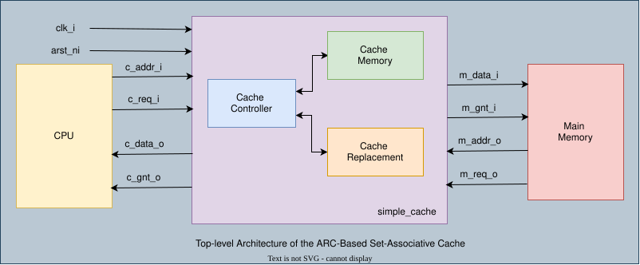
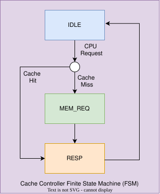

# Design an N-Way Set-Associative Cache Memory System Using the Adaptive Replacement Cache (ARC) Algorithm

# 1. Introduction

This project implements a **n-way Associative Cache Memory System** using SystemVerilog.

The main purpose of the cache is to reduce memory access time by storing frequently [LFU] and recently accessed data [LRU]. When the requester requests data, the cache is checked first. If the requested data is available, it is returned directly from the cache. Otherwise, the data is fetched from main memory and stored in the cache for future use.

This design uses the **Adaptive Replacement Cache (ARC)** algorithm to decide which cache block should be replaced when the cache is full.

The design consists of four main modules:

- `simple_cache`
- `cache_controller`
- `cache_memory`
- `cache_replacement`

# 2. System Architecture

### Top Architecture:

### Cache Controller's FSM:

## 2.1 simple_cache

*This is the top-level module of the design.*

**Main responsibilities:**

- Connects the requester to the cache controller.
- Sends address and request signals to the controller.
- Returns cache data and grant signals to the requester.
- Connects the cache system to main memory.

*It acts as the main interface of the entire cache system.*

## 2.2 cache_controller

*The cache controller manages the overall operation of the cache.*

**Main responsibilities:**

- Checks whether the requested data is available in the cache.
- Detects cache hits and misses.
- Sends memory requests when a cache miss occurs.
- Receives data from main memory.
- Updates the cache memory with the received data.
- Controls the replacement algorithm.
- Returns the requested data to the requester.

The controller uses a Finite State Machine (FSM) with three states.

| State   | Description                                             |
|---------|---------------------------------------------------------|
| IDLE    | Checks the cache for the requested data.                |
| MEM_REQ | Sends a request to main memory when a cache miss occurs.|
| RESP    | Returns the fetched data to the requester.              |

**Working procedure:**

1. The requester sends an address and request signal.
2. The controller checks the cache.
3. If a cache hit occurs, the requested data is returned immediately.
4. If a cache miss occurs, the controller sends a request to main memory.
5. When memory grants the request, the received cache line is stored in the cache.
6. The controller returns the requested data to the requester.

## 2.3 cache_memory

*This module stores the actual cache data.*

It contains three main memory arrays:

- `data_mem`: Stores the actual cache data.
- `tag_mem`: Stores the tag associated with each cache block.
- `valid_mem`: Indicates whether a cache block contains valid data.

**Main responsibilities:**

- Stores cache data, atgs and valid bits
- Searches for requested data.
- Detects cache hits.
- Returns the matching cache line.
- Stores new cache lines when a memory fill occurs.
- Provides victim information to the replacement module.

*The cache uses a set-associative organization. Each set contains multiple ways, allowing several memory blocks to be stored in the same set.*

## 2.4 cache_replacement

*This module implements the Adaptive Replacement Cache (ARC) algorithm.*

*ARC decides which cache block should be replaced when a new block needs to be inserted.*

It maintains four logical lists:

| List | Description                                              |
|------|----------------------------------------------------------|
| T1   | Stores recently accessed cache blocks.                   |
| T2   | Stores frequently accessed cache blocks.                 |
| B1   | Stores ghost entries of blocks recently removed from T1. |
| B2   | Stores ghost entries of blocks recently removed from T2. |

Ghost lists store only the tags of previously evicted blocks, not their actual data.

**Main responsibilities:**

- Tracks cache block usage.
- Promotes frequently accessed blocks from T1 to T2.
- Maintains ghost lists B1 and B2.
- Adjusts the adaptive parameter `p`.
- Selects a victim block for replacement.
- Updates replacement information after cache hits and misses.

The ARC algorithm balances between recently accessed and frequently accessed blocks to improve cache performance.

# 3. Cache Parameters

The design uses configurable parameters to support different cache configurations.

| Parameter    | Default Value | Description                                  |
|--------------|---------------|----------------------------------------------|
| `AW`         | 16            | Address width.                               |
| `C_DW`       | 8             | requester data width.                        |
| `M_DW`       | 128           | Main memory data width.                      |
| `CL`         | 256           | Total number of cache blocks.                |
| `NW`         | 4             | Number of ways.                              |
| `SETS`       | 64            | Number of cache sets.                        |
| `LINE_WORDS` | 16            | Number of requester words in one cache line. |
| `OFFSET_W`   | 4             | Number of offset bits.                       |
| `SET_W`      | 6             | Number of set index bits.                    |
| `TAG_W`      | 6             | Number of tag bits.                          |

## 3.1 Address Breakdown

The address is divided into three parts:

| Tag    | Set Index | Offset |
|--------|-----------|--------|
| 6 bits | 6 bits    | 4 bits |

# 4. Cache Operation

The cache performs two main operations.

### 4.1 Cache Hit

A cache hit occurs when the requested tag matches a valid tag in the selected set.

**Steps:**

1. The requester sends an address.
2. The cache identifies the set and tag.
3. The cache searches all ways in that set.
4. If a matching valid block is found, the corresponding cache line is selected.
5. The offset selects the required 8-bit word.
6. The data is returned to the requester.
7. The ARC replacement information is updated.

### 4.2 Cache Miss

A cache miss occurs when the requested tag is not found in the selected set.

**Steps:**

1. The controller detects the cache miss.
2. The requested address is stored.
3. A memory request is generated.
4. Main memory returns a complete cache line.
5. The ARC algorithm selects a victim way.
6. The new cache line, tag and valid bit are stored.
7. The fetched data is returned to the requester.

If the selected victim contains valid data, it's tag is stored in the appropriate ghost list.

# 5. ARC Replacement Algorithm

The ARC algorithm uses both recent and frequent access history to make replacement decisions.

- When a block is accessed for the first time, it is placed in T1.
- When a block in T1 is accessed again, it is promoted to T2.
- Blocks in T2 remain in T2 when accessed again.
- When a block is evicted from T1, it's tag is stored in B1.
- When a block is evicted from T2, it's tag is stored in B2.
- If a newly requested block is found in B1 or B2, the adaptive parameter `p` is adjusted.

The parameter `p` controls the balance between T1 and T2.

This allows the cache to adapt to different access patterns.

# 6. Input and Output Signals

## 6.1 Clock and Reset
| Signal    | Direction |Width| Description                    |
|-----------|-----------|-----|--------------------------------|
| `clk_i`   |   Input   |  1  | System clock.                  |
| `arst_ni` |   Input   |  1  | Active-low asynchronous reset. |

## 6.2 Cache (CPU-Side) Interface

| Signal     | Direction |Width | Description                                       |
|------------|-----------|------|---------------------------------------------------|
| `c_addr_i` | Input     |  AW  |Requested address from the cache requester.        |
| `c_req_i`  | Input     |  1   |Cache read request strobe (1: valid read request). |
| `c_data_o` | Output    | C_DW |Read data returned to the cache requester.         |
| `c_gnt_o`  | Output    |  1   |Indicates that the cache operation is complete.    |

## 6.3 Memory (Downstream) Interface

| Signal     | Direction | Width | Description                    |
|------------|-----------|-------|--------------------------------|
| `m_addr_o` | Output    |   AW  |Address sent to main memory.    |
| `m_req_o`  | Output    |   1   |Main memory request signal.     |
| `m_data_i` | Input     |  M_DW |Data received from main memory. |
| `m_gnt_i`  | Input     |   1   |Main memory grant signal.       |