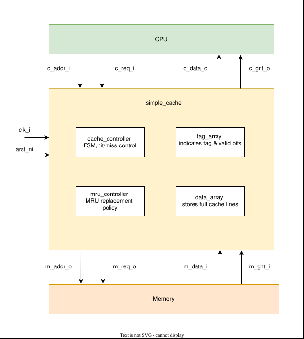
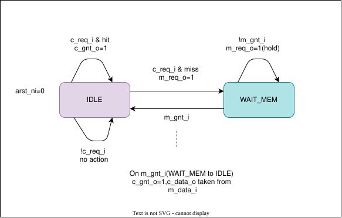

# Parameterizable Set-Associative Read-Only Cache

## 1. Overview

`simple_cache` is a parameterizable, set-associative, read-only cache implemented in SystemVerilog.

The cache is designed to interface between a requester (such as a CPU or DMA engine) and a backing main memory. It allows the requester to access individual data units while the memory transfers complete cache lines.

The design supports configurable address width, cache data width, memory data width, total cache lines, and associativity.

### Key Features

- Parameterizable cache architecture
- Set-associative cache organization
- Read-only cache operation
- MRU (Most Recently Used) replacement policy
- Invalid-way-first allocation
- Tag-based hit/miss detection
- Full cache-line storage
- Byte-level data extraction
- FSM-based cache controller
- Asynchronous active-low reset
- Separate tag, data, and replacement-policy modules

---

## 2. Default Configuration

| Parameter | Default Value | Description |
|---|---:|---|
| `AW` | 16 | Address width in bits |
| `C_DW` | 8 | Requester-side data width in bits |
| `M_DW` | 128 | Memory-side data width in bits |
| `CL` | 256 | Total number of cache lines |
| `NW` | 4 | Number of ways per set |

### Derived Parameters

| Parameter | Formula | Default Value | Description |
|---|---|---:|---|
| `NUM_SETS` | `CL / NW` | 64 | Number of cache sets |
| `OFFSET_W` | `$clog2(M_DW/8)` | 4 | Cache-line offset width |
| `INDEX_W` | `$clog2(NUM_SETS)` | 6 | Set index width |
| `TAG_W` | `AW - INDEX_W - OFFSET_W` | 6 | Tag width |
| `WAY_W` | `$clog2(NW)` | 2 | Way index width |

### Default Cache Specifications

| Specification | Value |
|---|---|
| Cache Organization | 4-Way Set Associative |
| Total Cache Lines | 256 |
| Number of Sets | 64 |
| Cache Line Size | 16 Bytes |
| Cache Capacity | 4 KB |
| Address Space | 64 KB |
| Replacement Policy | MRU |
| Requester Data Width | 8 Bits |
| Memory Transfer Width | 128 Bits |

---

## 3. Cache Top Architecture

### Submodules

| Module | Description |
|---|---|
| `simple_cache` | Top-level module connecting all cache components |
| `tag_array` | Stores tags and valid bits and performs hit detection |
| `data_array` | Stores cache lines and extracts requested data |
| `cache_controller` | Controls cache operation using an FSM |
| `mru_controller` | Selects replacement ways and maintains MRU ages |

---

## 4. Address Mapping

The memory address is divided into three fields:

  | TAG    | INDEX  | OFFSET |
  | ------ | ------ | ------ |
  | 6 bits | 6 bits | 4 bits |

The memory address is aligned to the cache-line boundary.

### Address Field Description

- **Tag:** Identifies the memory block stored in a cache way.
- **Index:** Selects the cache set.
- **Offset:** Selects the byte within the cache line.

## 5. Cache Operation

### 5.1 Read Hit

When the requester accesses an address:

1. The requester asserts `c_req_i`.
2. The tag array checks all ways in the selected set.
3. If a valid tag matches, a cache hit occurs.
4. The matching way is identified by internal signal `hit_way`.
5. The data array selects the corresponding cache line.
6. The requested byte is extracted using the offset.
7. `c_gnt_o` is asserted.
8. The MRU controller updates the access history.

### 5.2 Read Miss

When the requested address is not present:

1. The requester asserts `c_req_i`.
2. The tag array detects a miss.
3. The cache controller asserts `m_req_o`.
4. The memory responds by asserting `m_gnt_i` and providing `m_data_i`.
5. The MRU controller selects an invalid way or replacement victim.
6. The received cache line is stored in the selected way.
7. The tag array updates the tag and valid bit.
8. The requested byte is extracted directly from the incoming memory line through bypass.
9. `c_gnt_o` is asserted when the memory response is received.

### 5.3 Cache-Line Fill

A cache-line fill updates:

- The selected way's data.
- The corresponding tag.
- The corresponding valid bit.

The existing contents of the selected way are overwritten during the fill operation.

---

## 6. MRU Replacement Policy

The cache uses the **Most Recently Used (MRU)** replacement policy.

The replacement controller maintains an age value for each way in every set.

### Age Convention

| Age | Meaning |
|---:|---|
| 0 | Most recently used |
| 1 | Second most recently used |
| 2 | Third most recently used |
| 3 | Least recently used |

For a 4-way cache, each age value requires 2 bits.

### Replacement Selection

When all ways in a set are valid:

- The controller compares the age values of all ways.
- The way with the smallest age value is selected as the victim.
- Therefore, the most recently used way is replaced.

### Invalid-Way-First Allocation

Before applying the MRU replacement policy:

1. The controller checks whether an invalid way exists.
2. If an invalid way is found, it selects the first invalid way.
3. If all ways are valid, it selects the MRU victim.

### MRU Age Update

When a way is accessed:

- The accessed way receives age `0`.
- Other ways have their age incremented.
- Age values are limited to the maximum age.

When a new cache line is filled, the selected victim way is also touched and marked as MRU.

---

## 7. Module Descriptions

### 7.1 `simple_cache`

The top-level module integrates all submodules.

Responsibilities:

- Address decoding
- Tag array connection
- Data array connection
- MRU controller connection
- Cache controller connection
- Requester and memory interface handling

### 7.2 `tag_array`

The tag array stores the tag and valid bit for each cache way.

Responsibilities:

- Maintain tag memory
- Maintain valid bits
- Compare requested tag against stored tags
- Generate hit indication
- Identify matching way
- Update tag and valid bit during cache-line fill

### 7.3 `data_array`

The data array stores complete memory cache lines.

Responsibilities:

- Store incoming cache lines
- Select data from the matching cache way
- Select incoming memory data during bypass
- Extract the requested requester-side data unit

For the default configuration:

- `C_DW = 8`
- `M_DW = 128`
- Each cache line contains 16 bytes.

### 7.4 `cache_controller`

The cache controller uses a finite state machine (FSM).

#### States

| State | Description |
|---|---|
| `IDLE` | Accepts requester requests and checks hit/miss |
| `WAIT_MEM` | Waits for the memory response |

#### FSM Operation

The cache controller uses a two-state FSM to manage cache requests and memory transactions.

- **IDLE:** Accepts requester requests and checks cache hit/miss. On a hit, it asserts `c_gnt_o` and updates the MRU information. On a miss, it asserts `m_req_o` and transitions to `WAIT_MEM`.

- **WAIT_MEM:** Keeps `m_req_o` asserted while waiting for `m_gnt_i`. When memory responds, the controller triggers cache-line fill, enables data bypass, asserts `c_gnt_o`, updates MRU information, and returns to `IDLE`.

The FSM returns to `IDLE` after completing each request.

### 7.5 `mru_controller`

The MRU controller maintains age information for each way in each set.

Responsibilities:

- Select invalid ways before replacement
- Select the MRU victim when all ways are valid
- Update age information on cache access
- Update age information when a new cache line is filled

---

## 8. Interface Signals

### Requester Interface

| Signal | Direction | Width | Description |
|---|---|---|---|
| `c_addr_i` | Input | AW | Requester address |
| `c_req_i` | Input | 1 | Request signal |
| `c_data_o` | Output | C_DW | Requested data |
| `c_gnt_o` | Output | 1 | Request grant |

### Memory Interface

| Signal | Direction | Width | Description |
|---|---|---|---|
| `m_addr_o` | Output | AW | Cache-line-aligned memory address |
| `m_req_o` | Output | 1 | Memory request |
| `m_data_i` | Input | M_DW | Incoming cache-line data |
| `m_gnt_i` | Input | 1 | Memory grant |

### Clock and Reset

| Signal | Description |
|---|---|
| `clk_i` | Cache clock |
| `arst_ni` | Asynchronous active-low reset |

---

## 9. Requester Protocol

The requester must follow the request-grant protocol.

1. Assert `c_req_i` with the requested address.
2. Keep `c_req_i` asserted until `c_gnt_o` is asserted.
3. Capture `c_data_o` when `c_gnt_o` is asserted.
4. Deassert `c_req_i` after receiving the grant and capturing the data.

The requester must not withdraw the request before receiving the grant.

---

## 10. Reset Behavior

The cache uses an asynchronous active-low reset.

When `arst_ni` is asserted low:

- All valid bits are cleared.
- Tag memory is reset.
- MRU age information is initialized.
- Cache controller FSM returns to `IDLE`.

The data array is not explicitly reset. Invalid cache lines are identified using the valid bits.

---

## 11. Parameterization Requirements

The design supports configurable parameters.

For a valid configuration:

- `CL` must be divisible by `NW`.
- `NW` must be greater than zero.
- The number of sets must be a valid power of two for the current index calculation.
- The memory line size in bytes must be a power of two.
- `M_DW` must be divisible by 8.
- `C_DW` must be compatible with the memory data width.
- The address width must be sufficient to represent tag, index, and offset fields.

---

## 12. Limitations

- The cache supports read-only operations only.
- Write-back and write-through mechanisms are not implemented.
- The memory interface supports one outstanding request in the current FSM.
- The requester interface is designed for one request at a time.
- The current implementation uses a single memory response handshake.
- The MRU policy replaces the most recently used way rather than the least recently used way.
- The data array does not have an explicit reset; valid bits determine whether stored lines are usable.

---

## 14. Future Improvements

Possible future enhancements:

- Add configurable replacement policies such as LRU or FIFO.
- Support multiple outstanding memory requests.
- Add burst or pipelined memory interface support.
- Improve requester-side handshake timing.
- Add performance counters for cache hits and misses.
- Add parameter validation and configuration checks.
- Add comprehensive directed and random test cases.
- Add functional coverage for cache hits, misses, fills, and replacements.

---
